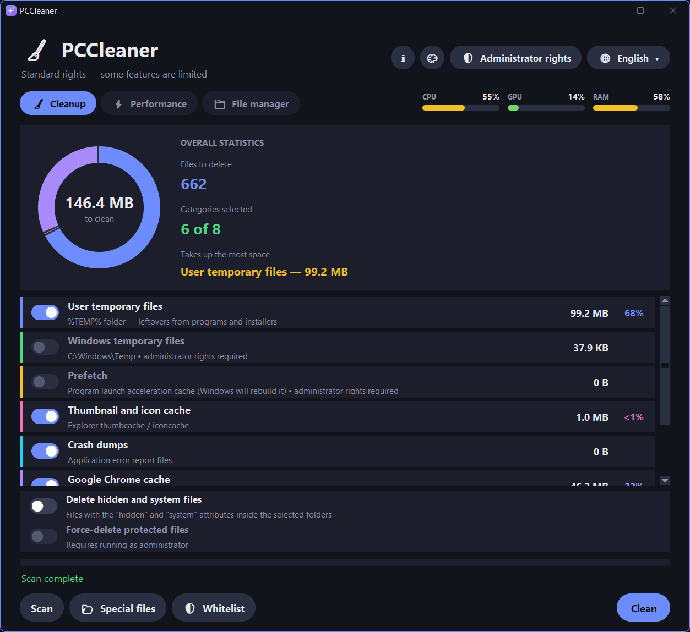
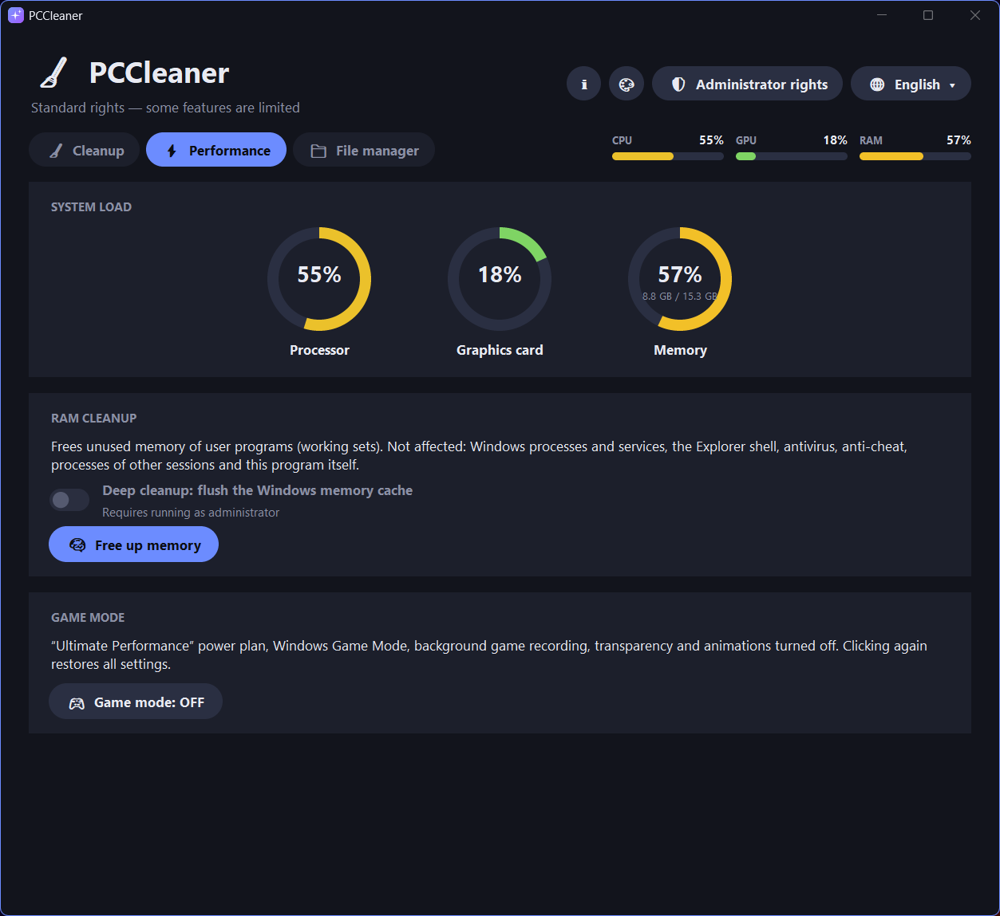
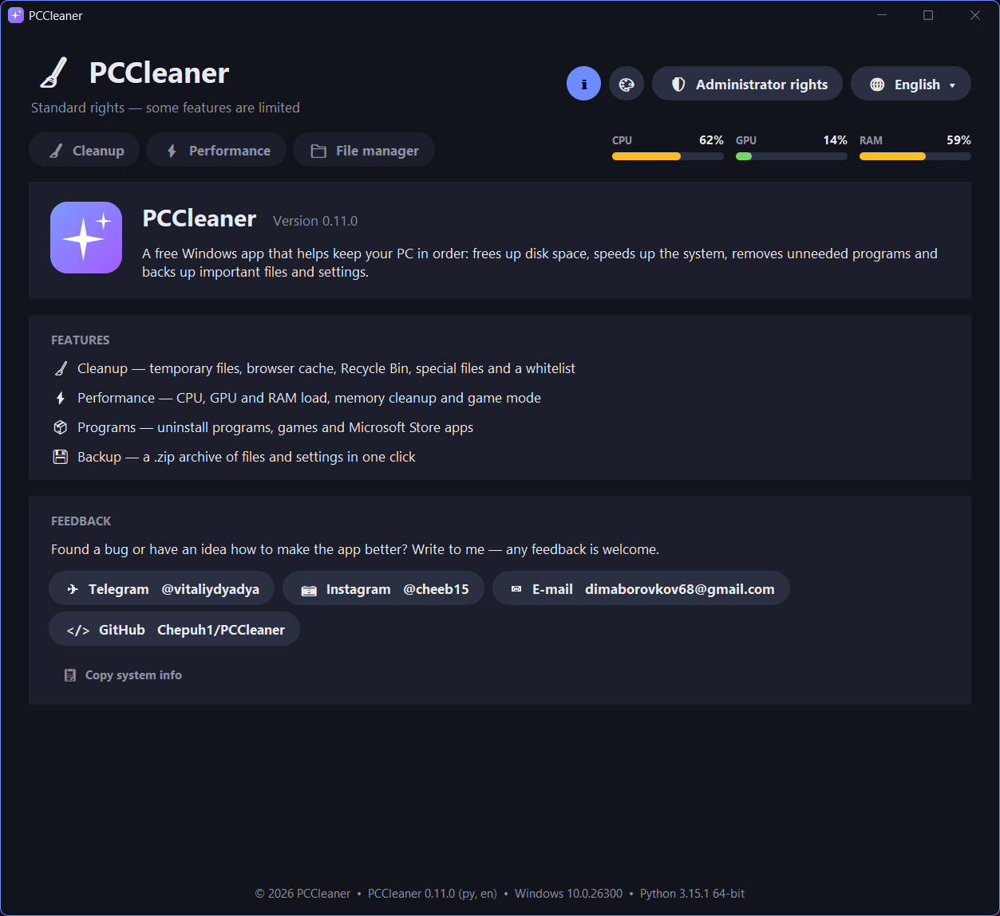
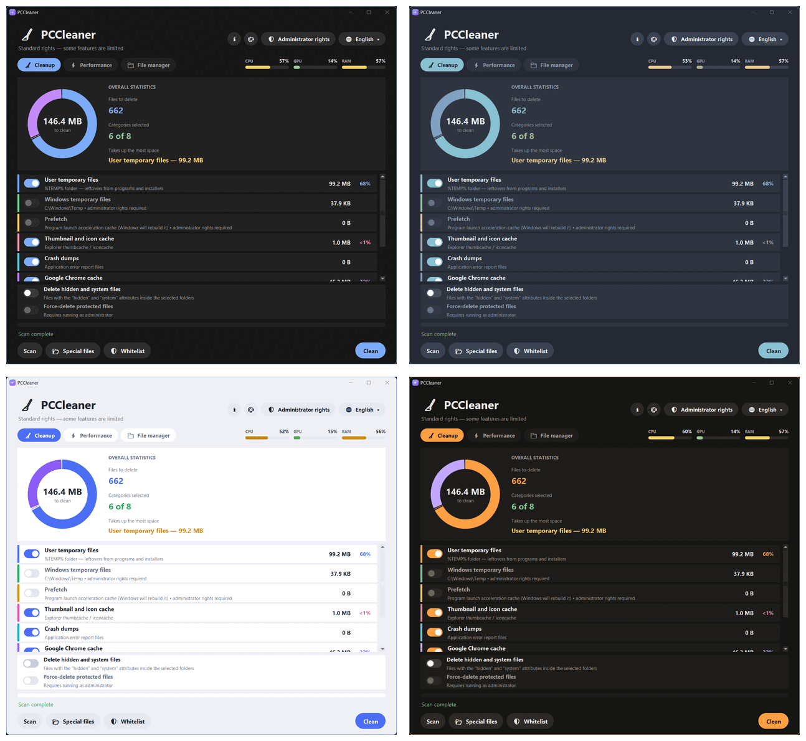

<div align="center">


# PCCleaner

**A free, lightweight Windows cleanup and maintenance tool**

Cleanup • Performance • Uninstaller • Backup — in one small app

[Download](https://github.com/Chepuh1/PCCleaner/releases/latest) · [Русская версия](README.ru.md)




</div>

## Features

**🧹 Cleanup**
- User and Windows temporary files, Prefetch, thumbnail and icon cache, crash dumps
- Google Chrome and Microsoft Edge cache, Recycle Bin
- Fast parallel scan with a live chart of what takes up space
- **Whitelist**: files and folders that are never deleted
- **Special files**: manually pick hidden, system, read-only and protected files

**⚡ Performance**
- Live CPU, GPU and RAM load
- Free up RAM by trimming user programs' working sets. Windows processes, antivirus and anti-cheat are left alone.
- **Game mode**: Ultimate Performance power plan, Windows Game Mode, fewer visual effects. One more click restores everything.

**📁 File manager**
- **Programs**: uninstall programs, games and Microsoft Store apps, with silent uninstall where supported
- **Backup**: pack files and configs into a `.zip` in one click, with your own folder and archive name (`{date}`, `{time}`, `{pc}`)

**🎨 Look & feel**
- 5 themes: Classic, GrapheneOS-style, Nord, Light, Graphite & Amber
- 2 languages: English and Russian
- Themes and languages switch instantly, with no restart
- Native Windows 11 look: dark title bar, rounded corners, accent window border

## Screenshots

| Performance | About |
|---|---|
|  |  |

**Themes**



## Download & run

1. Download `PCCleaner_x64.exe` from [Releases](https://github.com/Chepuh1/PCCleaner/releases/latest).
2. Run it. No installation needed.

Some actions (Windows temp files, Prefetch, deep memory cleanup, force-deleting protected files) need administrator rights. Use the **Administrator rights** button in the app.

> **Windows SmartScreen / antivirus warning.** The `.exe` isn't code-signed, so Windows may show "Windows protected your PC". Click **More info → Run anyway**. Some antivirus programs also flag apps packed with PyInstaller by mistake. If you'd rather not trust the binary, run from source or build it yourself (see below).

## Run from source

```bash
git clone https://github.com/Chepuh1/PCCleaner.git
cd PCCleaner
pip install -r requirements.txt   # Pillow, for smooth anti-aliased graphics
python cleaner.py
```

## Build the .exe

Run `build_exe_x64.bat` (requires 64-bit Python, installed with `py install 3-64`). The script:
- creates a `.venv64` environment
- installs PyInstaller and Pillow
- builds `dist\PCCleaner_x64.exe` with the app icon

## Settings & data

Settings (theme, language, whitelist, backup list) are stored in `%APPDATA%\PCCleaner\state.json`. The app doesn't send any data anywhere.

## Feedback

Found a bug or have an idea? [Open an issue](https://github.com/Chepuh1/PCCleaner/issues) or write to me:
- Telegram: [@vitaliydyadya](https://t.me/vitaliydyadya)
- Instagram: [@cheeb15](https://www.instagram.com/cheeb15/)
- E-mail: dimaborovkov68@gmail.com

When reporting a bug, the **About → Copy system info** button copies your app, Windows and Python versions.

## License

[MIT](LICENSE). Use the program at your own risk: deleted files cannot be restored.
