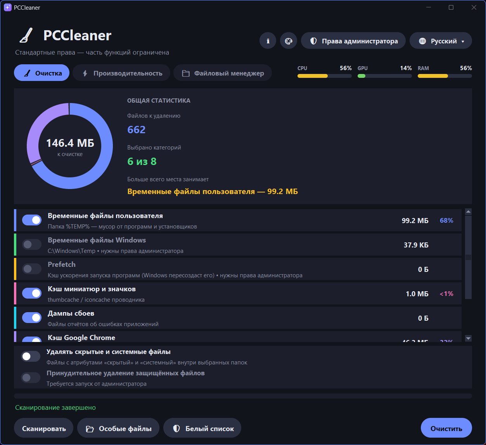
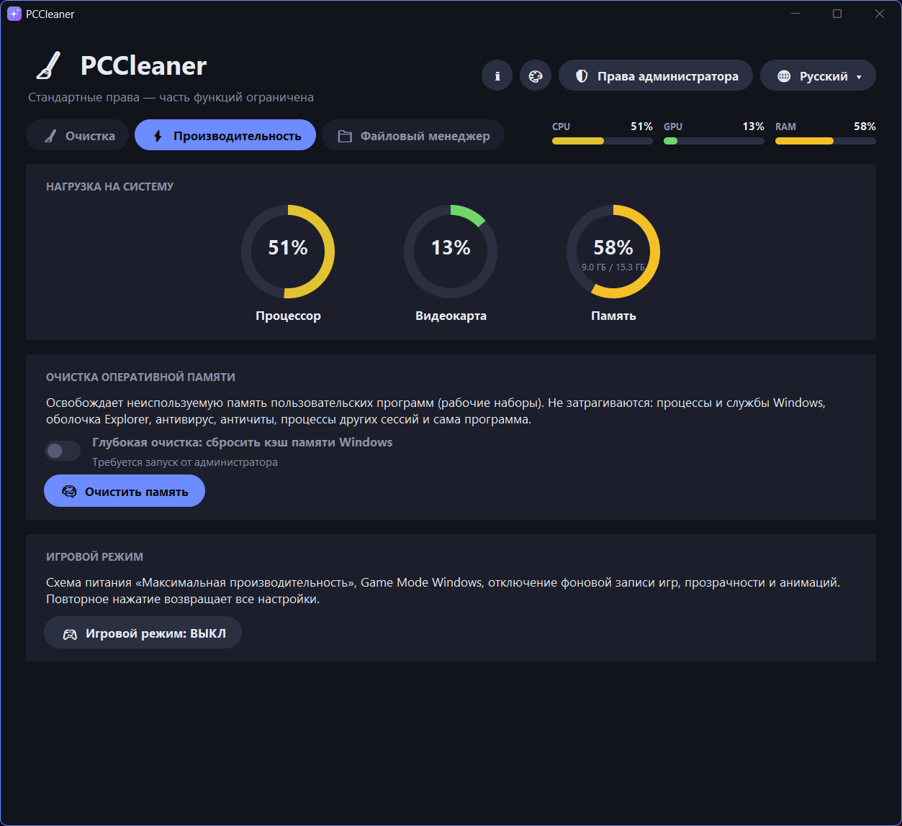
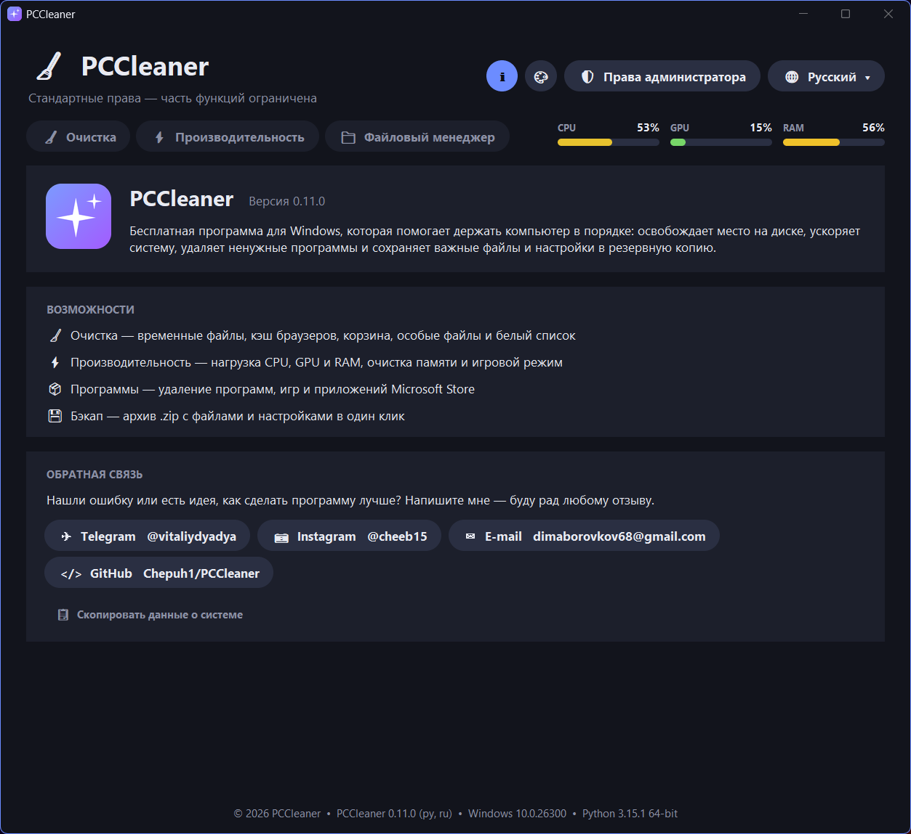
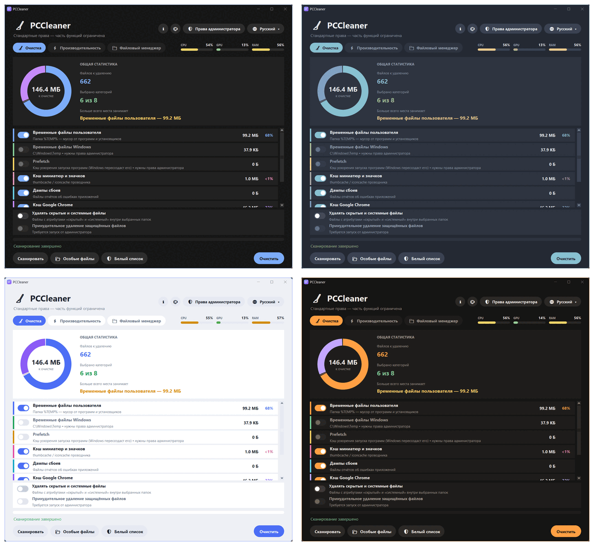

<div align="center">


# PCCleaner

**Бесплатная лёгкая программа для очистки и обслуживания Windows**

Очистка • Производительность • Удаление программ • Бэкап — в одном небольшом приложении

[Скачать](https://github.com/Chepuh1/PCCleaner/releases/latest) · [English version](README.md)




</div>

## Возможности

**🧹 Очистка**
- Временные файлы пользователя и Windows, Prefetch, кэш миниатюр и значков, дампы сбоев
- Кэш Google Chrome и Microsoft Edge, корзина
- Быстрое параллельное сканирование и живая диаграмма того, что занимает место
- **Белый список**: файлы и папки, которые никогда не удаляются
- **Особые файлы**: ручной выбор скрытых, системных, «только чтение» и защищённых файлов

**⚡ Производительность**
- Нагрузка CPU, GPU и RAM в реальном времени
- Очистка оперативной памяти: освобождаются рабочие наборы пользовательских программ. Процессы Windows, антивирус и античиты не затрагиваются.
- **Игровой режим**: схема питания «Максимальная производительность», Game Mode Windows, меньше визуальных эффектов. Повторное нажатие возвращает всё как было.

**📁 Файловый менеджер**
- **Программы**: удаление программ, игр и приложений Microsoft Store, тихое удаление, если программа его поддерживает
- **Бэкап**: архив `.zip` с файлами и конфигами в один клик, своя папка и имя архива (`{date}`, `{time}`, `{pc}`)

**🎨 Оформление**
- 5 тем: Стандартная, в стиле GrapheneOS, Nord, Светлая, Графит и янтарь
- 2 языка: русский и английский
- Тема и язык меняются мгновенно, без перезапуска
- Внешний вид в стиле Windows 11: тёмный заголовок, скруглённые углы, цветная рамка окна

## Скриншоты

| Производительность | О приложении |
|---|---|
|  |  |

**Темы оформления**



## Скачать и запустить

1. Скачайте `PCCleaner_x64.exe` в разделе [Releases](https://github.com/Chepuh1/PCCleaner/releases/latest).
2. Запустите его. Установка не нужна.

Часть действий требует прав администратора: временные файлы Windows, Prefetch, глубокая очистка памяти, удаление защищённых файлов. Для этого в программе есть кнопка **«Права администратора»**.

> **Предупреждение SmartScreen или антивируса.** `.exe` не подписан цифровой подписью, поэтому Windows может показать «Система Windows защитила ваш компьютер». Нажмите **«Подробнее» → «Выполнить в любом случае»**. Некоторые антивирусы также по ошибке реагируют на программы, собранные PyInstaller. Если не хотите доверять готовому файлу, запустите программу из исходников или соберите сами (см. ниже).

## Запуск из исходников

```bash
git clone https://github.com/Chepuh1/PCCleaner.git
cd PCCleaner
pip install -r requirements.txt   # Pillow — для гладкой сглаженной графики
python cleaner.py
```

## Сборка .exe

Запустите `build_exe_x64.bat`. Нужен 64-битный Python, ставится командой `py install 3-64`. Скрипт:
- создаёт окружение `.venv64`
- ставит PyInstaller и Pillow
- собирает `dist\PCCleaner_x64.exe` со значком программы

## Настройки и данные

Настройки (тема, язык, белый список, список для бэкапа) хранятся в `%APPDATA%\PCCleaner\state.json`. Программа никуда не отправляет данные.

## Обратная связь

Нашли ошибку или есть идея? [Создайте issue](https://github.com/Chepuh1/PCCleaner/issues) или напишите мне:
- Telegram: [@vitaliydyadya](https://t.me/vitaliydyadya)
- Instagram: [@cheeb15](https://www.instagram.com/cheeb15/)
- E-mail: dimaborovkov68@gmail.com

Если сообщаете об ошибке, кнопка **«О приложении» → «Скопировать данные о системе»** скопирует версии программы, Windows и Python.

## Лицензия

[MIT](LICENSE). Программа предоставляется «как есть»: удалённые файлы восстановить нельзя, используйте на свой риск.
